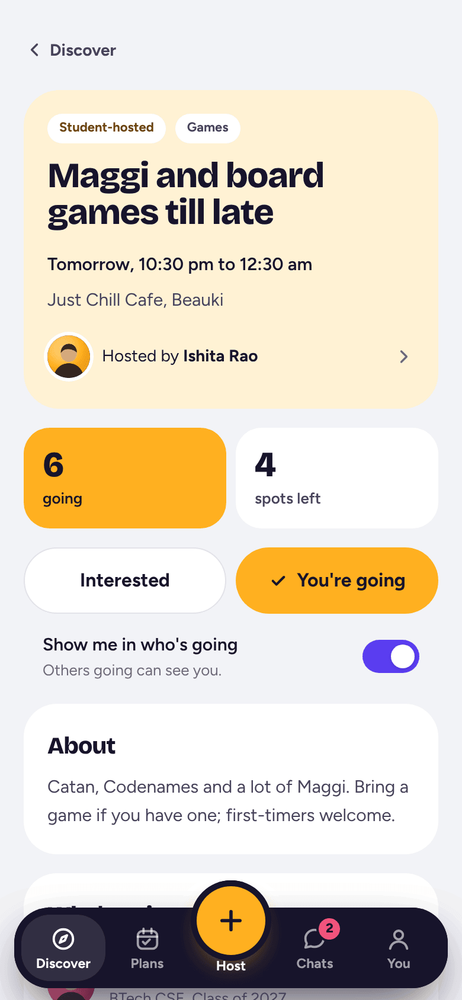
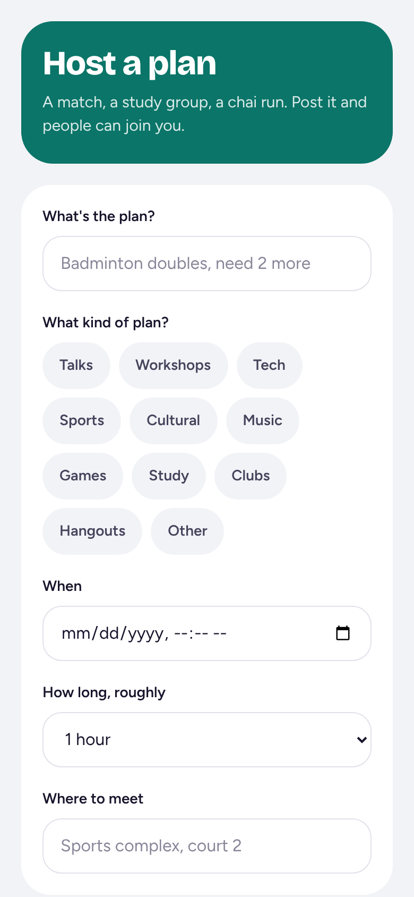
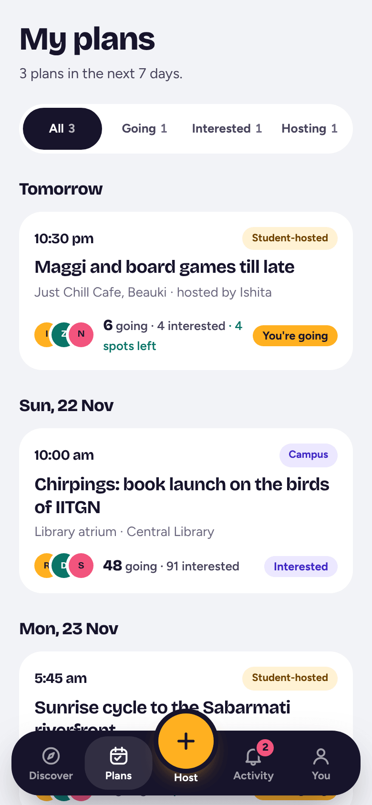
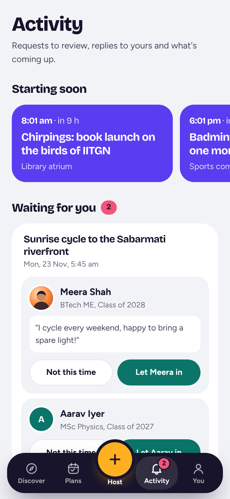
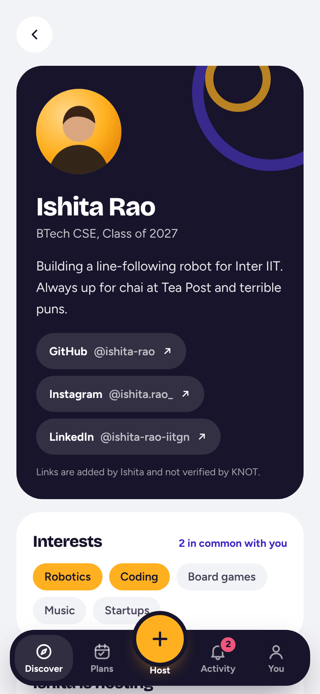
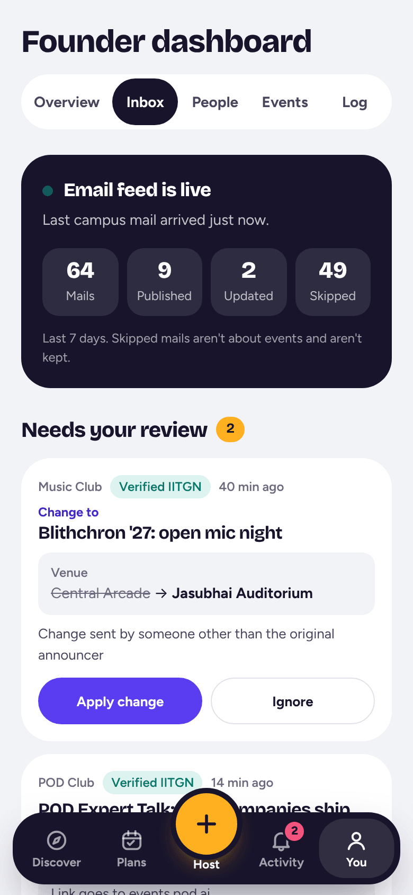
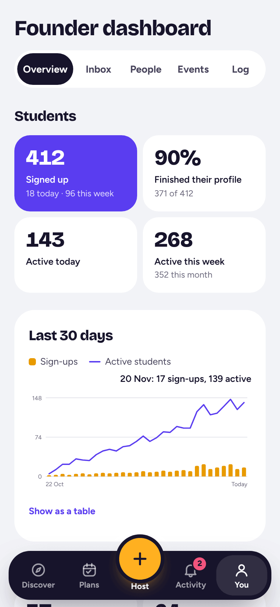
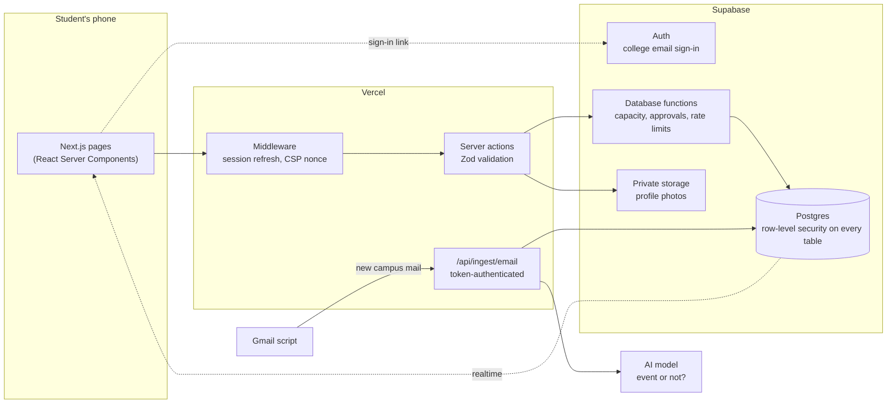

<div align="center">


# KNOT

**Stop hearing about it the next day.**

Every event at IIT Gandhinagar, who's going, and an easy way to go together.

[](https://github.com/Pritam-chavhan/knot/actions/workflows/ci.yml)


[**Open the app**](https://knot-tau.vercel.app) · [Architecture](docs/ARCHITECTURE.md) · [Security model](docs/SECURITY.md) · [Email feed](docs/EMAIL_FEED.md) · [Engineering rules](docs/ENGINEERING.md)


</div>

## Why KNOT

Campus life at IITGN runs on email. Talks, fests, club nights and workshops arrive as dozens of mails a day, mixed in with exam notices and fee circulars, and most students find out about the good ones after they've happened. Even when they do know, many skip events because they don't know who else is going.

KNOT turns that inbox into one live feed of what's on, shows how many people are going (and who, if they choose), and lets any student start a plan that others can join.

## What students get

| | |
|---|---|
| **One feed for campus** | Institute and club events (tagged **Campus**) and plans started by students (tagged **Student-hosted**), grouped by day, filterable by kind, and updated live while the screen is open. |
| **Interested or Going** | One tap. Everyone sees the counts; names appear only for students who choose to be visible. |
| **Host a plan** | A match, a study group, a chai run. Set the number of spots and choose whether anyone can join or people ask first. |
| **Join requests** | Students ask with a note, the host lets them in or says no, and the plan shows Full when spots run out. |
| **My plans** | Everything you're going to, interested in or hosting, sorted by day, with one-tap filters. |
| **Connect and chat** | Tap Connect on anyone's profile, with an optional note. Once they accept, you have a private one-to-one chat that updates live, with unread counts on the Chats tab. Nobody is told they were declined. |
| **Plan requests** | Requests to join your plans, replies to yours, and what starts in the next 24 hours, at the top of Chats. |
| **Block and report** | Block anyone from their profile or your chat: you disappear from each other everywhere and they aren't told. Report a profile, a message or an event in a few taps. |
| **Profiles** | An optional photo with a crop screen, a short bio, interests, and GitHub, Instagram and LinkedIn. Tap anyone's name to see their profile, the interests you share and the plans they're part of. |
| **Privacy by default** | College email only. Names hidden until a student opts in. Blocks hide people from each other everywhere. |
| **Hands-on onboarding** | A six-step tour where new students try each feature with example IITGN plans before setting up a profile. |

## For the team running it

| | |
|---|---|
| **Live campus email feed** | A small script in the founder's Gmail sends new campus mailing-list mail every minute. AI decides whether each mail announces an event, changes one (new time, new venue, cancelled) or is something else. Clear events from verified IITGN senders go live on their own; everything else waits for a quick look. [How it works](docs/EMAIL_FEED.md) |
| **Inbox** | Events to check (publish, edit or discard), proposed changes shown as before and after, and the feed's health and weekly numbers. |
| **Reports** | Each report shows exactly what was reported at that moment (for a message, the chat before it), with Dismiss, Hide event and Suspend, all logged. |
| **Founder dashboard** | Sign-ups, daily, weekly and monthly active students, a 30-day chart, people search, suspend and restore, admin roles, event moderation and an append-only audit log. |

## Screenshots

<table>
  <tr>
    <td align="center"><br /><sub>Sign in</sub></td>
    <td align="center"><br /><sub>Welcome tour</sub></td>
    <td align="center"><br /><sub>Discover</sub></td>
    <td align="center"><br /><sub>Event</sub></td>
    <td align="center"><br /><sub>Host a plan</sub></td>
  </tr>
  <tr>
    <td align="center"><br /><sub>My plans</sub></td>
    <td align="center"><br /><sub>Activity</sub></td>
    <td align="center"><br /><sub>Profile</sub></td>
    <td align="center"><br /><sub>Inbox</sub></td>
    <td align="center"><br /><sub>Dashboard</sub></td>
  </tr>
</table>

<sub>Screens shown with sample data.</sub>

## How it's built



- **The database is the security boundary.** Every table has row-level security. Anything with rules that must hold (taking the last spot, letting someone in, admin changes) runs in a Postgres function in one transaction, with the row locked.
- **Thin server layer.** Server actions validate input with Zod and act as the signed-in student. The service key is used only where a student can't act for themselves: the sign-up check, photo storage, account deletion and the email feed.
- **Locked-down pages.** A fresh nonce-based Content Security Policy on every request, HSTS, frame blocking and a strict permissions policy. No third-party scripts.

More in [docs/ARCHITECTURE.md](docs/ARCHITECTURE.md).

## Security and privacy

- **Who can join.** Any `iitgn.ac.in` address, including subdomains such as `caa.iitgn.ac.in`, with `iitgn.ac.in` fixed at the end so look-alike domains are refused. Shared office and club mailboxes are blocked.
- **What students can write.** Events, attendance, join requests, connections, messages, blocks and reports only go through database functions that enforce capacity, approval, blocks and rate limits.
- **Private chats.** Only the two connected students can read a chat, live updates included. Admins never browse chats; they see a message only when someone reports it.
- **What classmates can see.** Names, programme, bio, photo and links. Never email addresses, last-seen times or roles.
- **Photos.** Re-encoded on the server (removing phone location data), stored privately, and served only to signed-in students who can see that profile.
- **Campus mail.** Mail that isn't about an event is discarded on arrival. Email addresses and phone numbers are removed before any mail reaches the AI, and kept text is erased after 30 days.
- **Admins.** Every admin action is logged in an append-only audit log. The founder can't be suspended or demoted, and only the founder can change another admin.

Every feature was reviewed against these rules by an independent security review before release, and each finding is covered by a test. Full details in [docs/SECURITY.md](docs/SECURITY.md); to report a problem, see [SECURITY.md](SECURITY.md).

## Quality

| Check | Result |
|---|---|
| Unit and database security tests (Vitest, in-process Postgres) | 188 passing |
| Browser tests (Playwright) with accessibility scans (axe) | 7 passing |
| Lighthouse, landing page on a phone | Performance 96 · Accessibility 100 · Best practices 100 · SEO 100 |
| Accessibility | WCAG 2.2 AA, 44 px touch targets, keyboard and screen reader friendly |
| Dependencies | 0 known vulnerabilities |

CI runs lint, type checks, all tests, a dependency audit, a production build and the browser tests on every push.

## Tech stack

- **App:** Next.js 15 (App Router, Server Components, Server Actions), React 19, TypeScript, Tailwind CSS 4
- **Data:** Supabase (Postgres with row-level security, Auth, Storage, Realtime)
- **AI:** Google Gemini API for reading campus mail, with the Anthropic API as a drop-in alternative
- **Images:** sharp, for server-side re-encoding of profile photos
- **Validation:** Zod
- **Testing:** Vitest with PGlite for database tests, Playwright with axe-core for browser tests
- **Hosting:** Vercel
- **Type:** Bricolage Grotesque and Figtree, self-hosted

## Project structure

```
app/
  (app)/                Signed-in pages: discover, events, host, plans, activity, people, profile, admin
  api/ingest/email/     Endpoint the Gmail script posts campus mail to
  avatar/               Auth-checked profile photo route
  welcome/, onboarding/ Welcome tour and first-time profile setup
components/             Shared UI, tab bar, live updates, illustrations and demos
features/
  events/               Feed, event page, hosting, join requests
  ingest/               Email feed: AI extraction and decision rules
  admin/                Dashboard, Inbox, people, events, audit log
  profile/, people/     Your profile, photos, links, classmates' profiles
  chat/                 Connect, chats, blocking and reports
  plans/, activity/     The Plans tab and plan requests
lib/                    Auth helpers, Supabase clients, security headers, time zone helpers
supabase/migrations/    Schema, access rules and database functions, in order
tests/                  Unit, database security and browser tests
tools/gmail-feed.gs     The Google Apps Script that feeds campus mail
docs/                   Architecture, security model, email feed, engineering rules
```

## Running it locally

**You'll need** Node.js 22 and a Supabase project.

```bash
npm install
cp .env.example .env.local     # fill in the values below
npm run dev
```

Apply the files in `supabase/migrations/` in order, then `supabase/seed.sql`, in your Supabase project.

| Setting | What it's for |
|---|---|
| `NEXT_PUBLIC_SUPABASE_URL`, `NEXT_PUBLIC_SUPABASE_ANON_KEY` | Your Supabase project |
| `SUPABASE_SERVICE_ROLE_KEY` | Server only: sign-up check, photos, account deletion, email feed |
| `NEXT_PUBLIC_INSTITUTION_DOMAIN` | `iitgn.ac.in` |
| `AI_PROVIDER`, `AI_MODEL` | `gemini` or `anthropic`, and the model to use (email feed only) |
| `GEMINI_API_KEY` or `ANTHROPIC_API_KEY` | Key for the chosen AI provider (email feed only) |

```bash
npm run lint        # code style
npm run typecheck   # TypeScript
npm test            # unit and database security tests
npm run build       # production build
npm run test:e2e    # browser and accessibility tests
```

To connect campus mail, follow [docs/EMAIL_FEED.md](docs/EMAIL_FEED.md).

## Roadmap

- [x] College email sign-in and onboarding with an interactive tour
- [x] Event feed, Going and Interested, hosted plans with join requests
- [x] Founder dashboard with activity stats, moderation and an audit log
- [x] Profiles with photos and links, My plans, Activity, five-tab navigation
- [x] Live campus email feed with AI reading and a review Inbox
- [x] Connection requests and live one-to-one chat between connected students
- [x] Block and report everywhere, with a Reports queue in the dashboard
- [ ] Opt-in live campus map: share where you are for a set time, stop anytime, no history kept
- [ ] Privacy policy and terms pages, a custom domain and a branded sign-in email

## Author

Designed and built by **Pritam Chavhan**.

© 2026 Pritam Chavhan. All rights reserved. KNOT is an independent student project and is not affiliated with IIT Gandhinagar.
