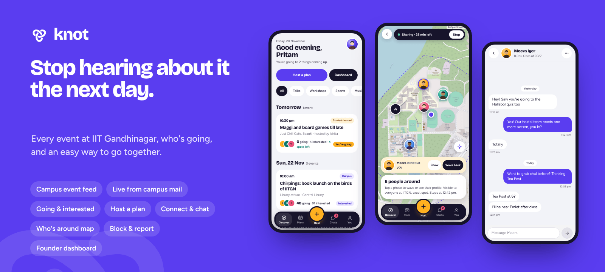
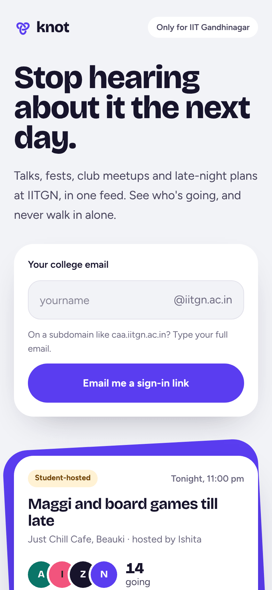
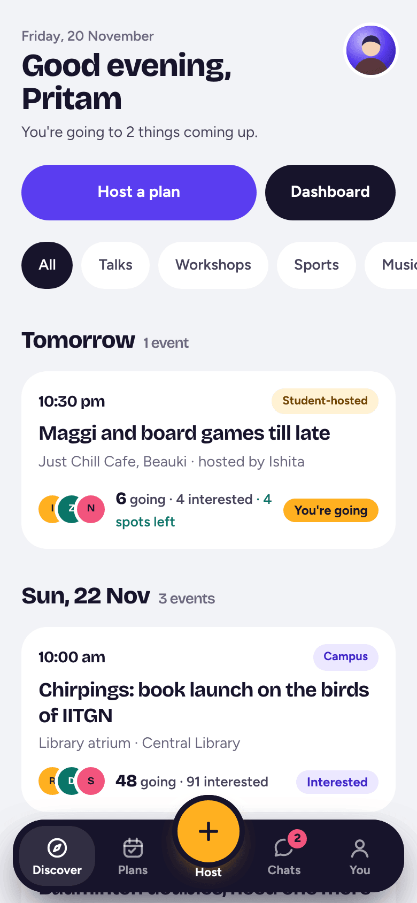
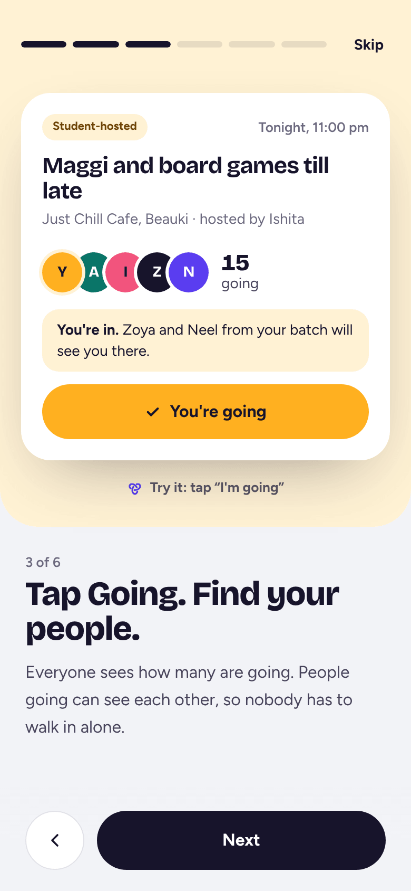
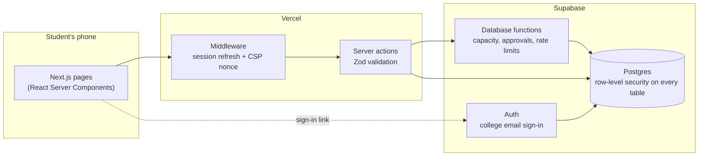
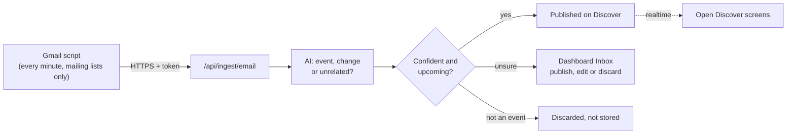

<div align="center">


# KNOT

**Stop hearing about it the next day.**

Every event at IIT Gandhinagar, who's going, and an easy way to go together.

[](https://github.com/Pritam-chavhan/knot/actions/workflows/ci.yml)


[**Live app**](https://knot-tau.vercel.app) · [Engineering rules](docs/ENGINEERING.md)



</div>

## Why KNOT

Campus life at IITGN runs on email. Talks, fests, club nights and late-night plans arrive as dozens of mails a day, and most students find out about the good ones after they've happened. Even when they do know, many skip events because they don't know who else is going.

KNOT puts everything happening on campus in one feed, shows how many people are going (and who, if they choose), and lets any student start a plan that others can join.

## What it does

| | |
|---|---|
| **One feed for campus** | Campus events (institute and clubs) and plans started by students, grouped by day and filterable by kind. Each card shows the time, place, how many are going and who. |
| **Interested or Going** | One tap. Everyone sees the counts; names appear only for students who choose to be visible. |
| **Host a plan** | A match, a study group, a chai run. Set the number of spots and choose whether anyone can join or people ask first. |
| **Join requests** | For plans that need the host's OK: students ask with a note, the host lets them in or says no, and the plan shows Full when spots run out. |
| **Profiles with photos and links** | An optional photo with a crop screen, plus GitHub, Instagram and LinkedIn. Tap anyone's name to see their profile, the interests you share and the plans they're part of. |
| **My plans** | Everything you're going to, interested in or hosting, sorted by day, with one-tap filters. |
| **Activity** | Join requests waiting for you (with a badge in the tab bar), replies to your requests and what's starting in the next 24 hours. |
| **Privacy by default** | College email only. Names hidden until a student opts in. Blocks hide people from each other everywhere. |
| **Live campus email feed** | A small script in the founder's Gmail sends new mailing-list mail to KNOT every minute. AI decides whether each mail announces an event, changes one (new time, new venue, cancelled) or is unrelated. Clear events go live on their own, unclear ones wait in the dashboard Inbox, and open Discover screens show a "new events" pill straight away. |
| **Founder dashboard** | Sign-ups, daily and weekly active students, a 30-day chart, people search, suspend and restore, admin roles, event moderation and an audit log. |
| **Hands-on onboarding** | A six-step tour where new students try each feature with example IITGN plans before they set up a profile. |

Coming next: connection requests and chat, block and report everywhere, and an opt-in live campus map.

## Screenshots

<table>
  <tr>
    <td></td>
    <td></td>
    <td></td>
  </tr>
  <tr>
    <td></td>
    <td></td>
    <td></td>
  </tr>
</table>

## Architecture



- **The database is the security boundary.** Every table has row-level security. Anything with rules that must not be skipped (taking the last spot, letting someone in, hosting limits) runs inside a Postgres function in one transaction, with the event row locked so two people can't take the same spot.
- **Thin server layer.** Server actions validate input with Zod and call the database as the signed-in student. The privileged key is used only for the sign-up domain check and account deletion.
- **Locked-down pages.** A fresh nonce-based Content Security Policy on every request, plus HSTS, frame blocking and a strict permissions policy. No third-party scripts.

## Security and privacy

- Sign-up is limited to `@iitgn.ac.in` and `@caa.iitgn.ac.in`, with shared office and club mailboxes blocked.
- Students can't write events, attendance or join requests directly. Database functions enforce capacity, host approval, blocks and rate limits.
- Attendee names are hidden unless a student opts in. Counts include everyone.
- Blocks hide people from each other in profiles, feeds, attendee lists and requests, in both directions.
- Admin actions are recorded in an audit log, and admins can't suspend or demote themselves.
- Activity tracking is one row per student per day, used only for active-user counts.
- Profile photos live in a private bucket. Every upload is re-encoded on the server, which removes location data from phone photos, and photos are only served to signed-in students who can see that profile.
- The email feed authenticates with a random token whose SHA-256 is the only thing stored. Mail that isn't about an event is discarded on arrival; only a fingerprint of its Message-ID is kept so it's never processed twice. Mail content is treated as untrusted: the AI's answer is validated field by field, and links must be `https://`. Only mail whose IITGN sender passed Gmail's DMARC check can publish on its own, and a mail can only change or cancel an event the same sender announced; anything else waits for review.
- Links are stored as usernames and always rebuilt as links to the official site, so a profile can't point anywhere else.
- Every change is reviewed against these rules. Findings and fixes are covered by tests in `tests/db/`.

## Quality

| Check | Result |
|---|---|
| Unit and database security tests (Vitest, in-process Postgres) | 102 passing |
| Browser tests (Playwright) including accessibility scans (axe) | 7 passing |
| Lighthouse, landing page on a phone | Performance 99 · Accessibility 100 · Best practices 100 · SEO 100 |
| Accessibility | WCAG 2.2 AA, 44 px touch targets, keyboard and screen reader friendly |
| Production dependencies | 0 known vulnerabilities |

CI runs lint, type checks, all tests, a dependency audit, a production build and the browser tests on every push.

## Campus email feed



Setup: run [`tools/gmail-feed.gs`](tools/gmail-feed.gs) in Google Apps Script with your feed token, and set `AI_PROVIDER`, its API key and `AI_MODEL` on the server. Email addresses and phone numbers are removed from each mail before it is sent to the AI provider.

## Tech stack

- **App:** Next.js 15 (App Router, Server Components, Server Actions), React 19, TypeScript, Tailwind CSS 4
- **Data:** Supabase (Postgres, row-level security, Auth)
- **AI:** Google Gemini API for reading campus mail (Anthropic API supported as an alternative)
- **Validation:** Zod
- **Testing:** Vitest with PGlite for database tests, Playwright with axe-core for browser tests
- **Hosting:** Vercel
- **Type:** Bricolage Grotesque and Figtree, self-hosted

## Project structure

```
app/                  Pages and layouts (signed-in pages live in app/(app))
components/           Shared UI, illustrations and interactive demos
features/             Feature modules: auth, profile, discover, events, admin
lib/                  Auth helpers, Supabase clients, security headers, time zone helpers
supabase/migrations/  The database schema, access rules and functions
tests/                Unit, database and browser tests
docs/                 Engineering rules and screenshots
```

## Running it locally

```bash
npm install
cp .env.example .env.local     # add your Supabase project URL and keys
npm run dev
```

Apply the files in `supabase/migrations/` in order, then `supabase/seed.sql`, in your Supabase project.

```bash
npm run lint        # code style
npm run typecheck   # TypeScript
npm test            # unit and database security tests
npm run build       # production build
npm run test:e2e    # browser and accessibility tests
```

## Author

Built by **Pritam Chavhan**.

KNOT is an independent student project and is not affiliated with IIT Gandhinagar.
