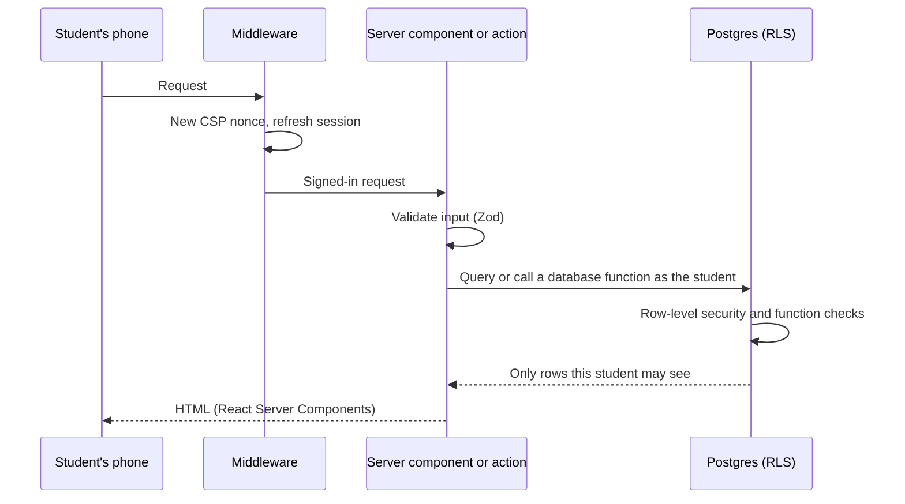

# Architecture

KNOT is a Next.js 15 app on Vercel backed by Supabase (Postgres, Auth, Storage and Realtime). This page explains how a request moves through it and where each rule is enforced.

## Request flow

1. **Middleware** (`middleware.ts`) sets a fresh Content Security Policy nonce on every request, refreshes the Supabase session cookie, and sends signed-out visitors to the landing page.
2. **The app layout** (`app/(app)/layout.tsx`) requires a signed-in, active, onboarded student (`lib/auth.ts`), records the day as active for the dashboard, and counts requests waiting for the tab-bar badge.
3. **Pages and server actions** use a Supabase client that acts as the signed-in student (`lib/supabase/server.ts`), so the database decides what they can read and write.

## Where rules live

| Rule | Enforced in |
|---|---|
| Who can see a profile, event, attendee or request | Row-level security policies |
| Capacity, join approval, hosting limits, rate limits | Database functions in one transaction, with the row locked |
| Which profile columns classmates can read | Column-level grants (no email, last-seen time or role) |
| Admin changes (status, roles, events, edits) | `admin_*` database functions that check the caller and write the audit log |
| Input shape and limits | Zod schemas on the server, then database check constraints |
| Page security headers | `lib/security/csp.ts`, applied by middleware |

Students never insert or update events, attendance, join requests, connections, messages, blocks or reports directly. They call functions such as `set_my_participation`, `request_to_join`, `send_connection_request`, `send_message` and `file_report` (see `supabase/migrations/`).

## The service key

The service-role client (`lib/supabase/admin.ts`) is server-only and used only where a student can't act for themselves:

- checking whether an email address may sign up,
- storing and serving profile photos from the private bucket,
- deleting an account and its photos,
- the campus email feed (`app/api/ingest/email`).

It has table access only to what the email feed uses (`supabase/migrations/20261120080000_service_role_grants.sql`).

## Feature modules

Each feature keeps its data access, server actions and UI together under `features/`:

| Module | What it holds |
|---|---|
| `events` | Feed and event queries, Going and Interested, hosting, join requests, the event page |
| `ingest` | Email feed: AI extraction (`extract.ts`), decision rules (`decide.ts`), processing (`process.ts`) |
| `admin` | Dashboard stats and chart, Inbox, people, events, audit log |
| `map` | The live campus map: sharing, positions, waves (Leaflet with OpenStreetMap tiles, loaded only on the map page) |
| `chat` | Connect, the Chats tab, live one-to-one chat, blocking and reports |
| `profile`, `people` | Your profile, photo upload and crop, links, classmates' profiles |
| `plans`, `activity` | The Plans and Activity tabs |
| `auth`, `discover` | Sign-in validation, the Discover screen |

## Live updates

The `events` table is published to Supabase Realtime. Discover subscribes as the signed-in student, so row-level security decides which changes each student receives. A new or newly approved event shows a "new events" pill; changes to events already on screen refresh quietly, at most every 30 seconds.

Messages are published too. An open chat adds new messages as they arrive, and sends with an id made on the phone, so a retry after a dropped connection never creates a duplicate. The Chats list refreshes when any of your chats gets a message. Row-level security means each student only ever receives their own chats.

## Profile photos

1. The phone crops the photo to a square and sends a JPEG.
2. The server checks the file type from its first bytes, then re-encodes it to a 512 px WebP with `sharp`. This also removes metadata such as GPS location.
3. The file goes to a private bucket under the student's own folder, and `set_avatar` records it.
4. `/avatar/[id]/[file]` serves it only to signed-in students who can see that profile, checking access on every view.

## Campus email feed

See [EMAIL_FEED.md](EMAIL_FEED.md).

## Testing

- **Database tests** (`tests/db`) run every migration in an in-process Postgres (PGlite) and check the access rules as different students and admins.
- **Unit tests** (`tests/unit`) cover validation, security headers, link parsing, the email feed's decision rules and AI handling, and the Gmail script's sender check.
- **Browser tests** (`tests/e2e`) run the public pages in Chromium with axe accessibility scans.
