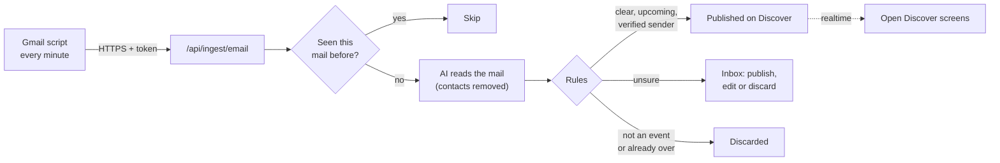

# Campus email feed

Most campus events at IITGN are announced on mailing lists. The email feed turns those mails into events on Discover, usually within a minute, without anyone copying them by hand.

## What happens to each mail

1. **Collect.** A Google Apps Script in the founder's IITGN Gmail (`tools/gmail-feed.gs`) runs every minute. It picks up mail that came through an `iitgn.ac.in` mailing list and was sent from an `iitgn.ac.in` address. Personal mail, newsletters and account notices don't match.
2. **Verify the sender.** The script reads the result of Gmail's own DMARC check on arrival. Only mail that passed for an `iitgn.ac.in` address counts as verified.
3. **Send.** Up to 10 mails a minute go to `/api/ingest/email`, authenticated by a private token.
4. **Deduplicate.** The server fingerprints each Message-ID and claims it, so a mail is handled once even if it arrives twice.
5. **Read.** Email addresses and phone numbers are removed, and the mail is sent to the AI model with the list of known upcoming events. The model answers in a fixed JSON shape: a new event, a change to a known event, a cancellation, a reminder, or nothing.
6. **Decide.** Fixed rules (`features/ingest/decide.ts`) decide what to do with the answer:

| Answer | Goes live on its own when | Otherwise |
|---|---|---|
| New event | Verified IITGN sender, AI at least 80% sure, time stated, link on a familiar site (or none), within a year | Waits in the Inbox with the reason |
| Change of time or venue | Same verified sender who announced the event, AI at least 80% sure | Shown in the Inbox as before → after |
| Cancellation | Same verified sender who announced the event | Shown in the Inbox to confirm |
| Reminder, past event, not an event | Never stored | |

7. **Show.** Published events appear on Discover straight away, and open screens show a "new events" pill.

## Privacy

- Mail that isn't about an event is discarded on arrival. Only its fingerprint is kept, and a database constraint makes sure no text is stored with it.
- Before any mail reaches the AI provider, email addresses and phone numbers are blanked out and only the sender's display name is included.
- Text kept for review is erased 30 days after processing.
- Descriptions are scrubbed of phone numbers and email addresses before publishing.

## Safety

- **Untrusted content.** Mail text is fenced off with a random marker and escaped, so it can't pose as instructions. The model's answer is validated field by field before anything is written.
- **Links.** Must be plain `https://` links. Links that hide another site behind a name (`https://iitgn.ac.in@other.example`) are refused, and unfamiliar sites send the event to review.
- **Changes.** A mail can only change or cancel institute and club events, never a student's plan, and only events the same sender announced.
- **Limits.** The endpoint caps request size, mails per request, processing time and mails per hour. A mail that keeps failing is marked Failed after five attempts and shown in the Inbox.

## Setting it up

1. **AI provider.** Create a Gemini API key at Google AI Studio (the free tier works) and set these on the server:
   - `AI_PROVIDER=gemini`
   - `GEMINI_API_KEY`
   - `AI_MODEL` (for example `gemini-3.5-flash-lite`)

   To use Anthropic instead, set `AI_PROVIDER=anthropic` and `ANTHROPIC_API_KEY`.
2. **Script.** Signed in to the IITGN Google account that receives the lists, create a project at script.google.com and paste in `tools/gmail-feed.gs`.
3. **Token.** Run `createToken` and allow access. It keeps a private token in the script's own settings and logs only its SHA-256 fingerprint. Store that fingerprint in `institutions.ingest_token_hash`. The token itself is never copied anywhere.
4. **Check.** Run `checkQuery` to see which mails would be sent. Only you can see this log.
5. **Start.** Run `setup`. It checks every minute and catches up on the last three days of mail.

To pause the feed, run `stop`. To replace the token, run `createToken` again and store the new fingerprint.
